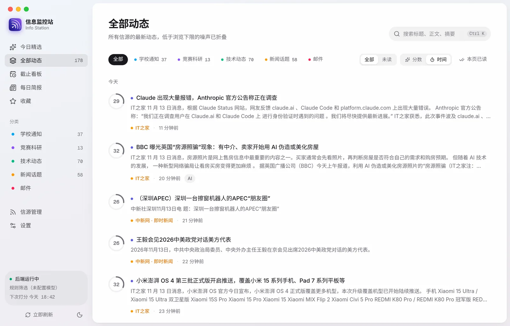
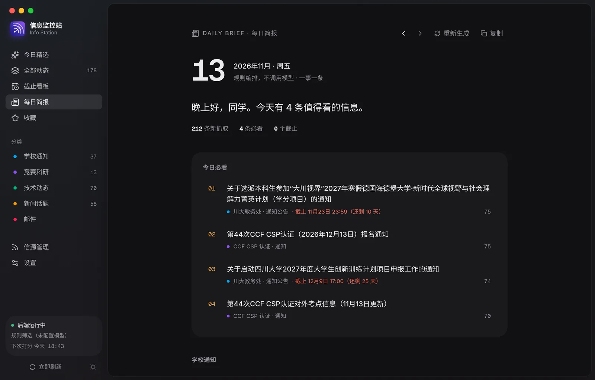
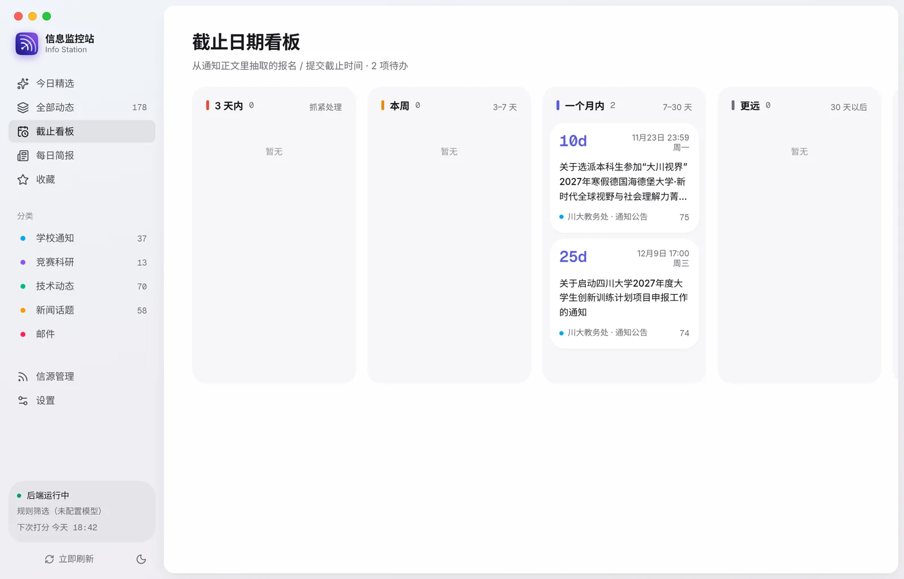
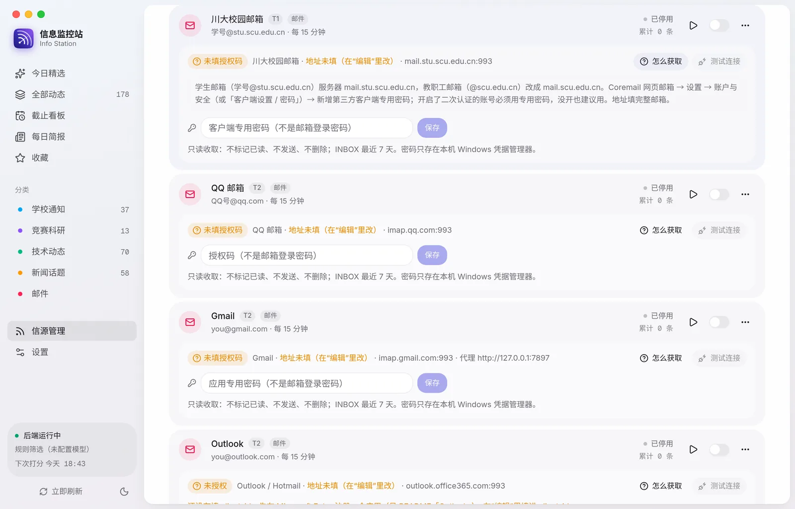
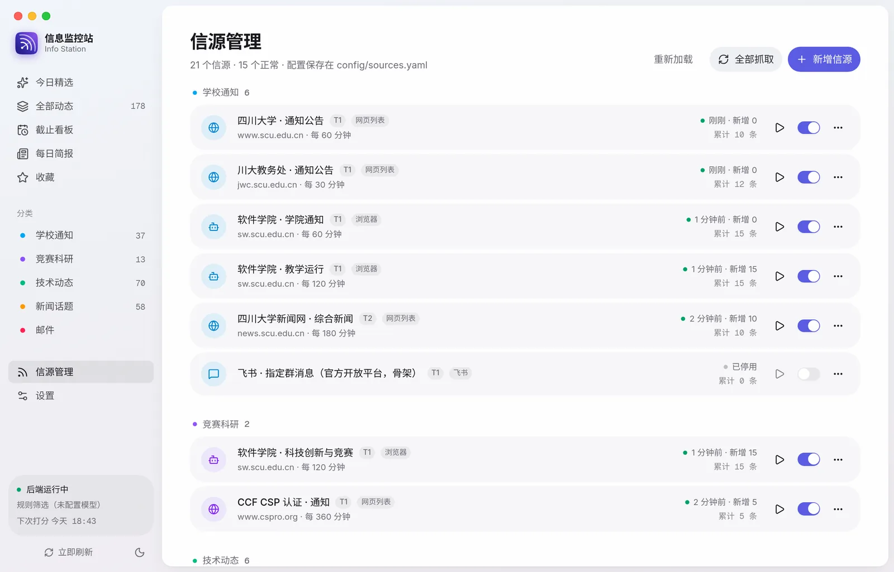
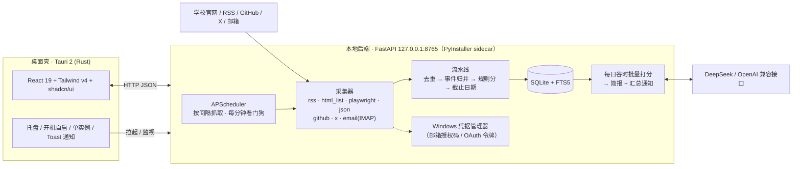

<div align="center">


# 信息监控站 · Info Station

**把学校通知、竞赛科研、技术动态、新闻和邮件汇到一个安静的桌面窗口里，<br>规则先筛一轮；有模型 Key 时，每天在 DeepSeek 谷时再打一次分。**

[](https://github.com/Qiuizi/info-station/releases)
[](LICENSE)


[**下载 v0.1.0**](#download) · [Releases / latest](https://github.com/Qiuizi/info-station/releases/latest) · [项目主页](https://qiuizi.github.io/info-station/) · [English](#english)

</div>

<a id="download"></a>

## 下载 v0.1.0

Windows 10 / 11（64 位）。当前最新发布：**<https://github.com/Qiuizi/info-station/releases/latest>**

| 安装包 | 文件 | 说明 |
| --- | --- | --- |
| **NSIS（推荐）** | [InfoStation_0.1.0_x64-setup.exe](https://github.com/Qiuizi/info-station/releases/download/v0.1.0/InfoStation_0.1.0_x64-setup.exe) | 装到当前用户，不需要管理员。约 64 MB |
| **MSI** | [InfoStation_0.1.0_x64_zh-CN.msi](https://github.com/Qiuizi/info-station/releases/download/v0.1.0/InfoStation_0.1.0_x64_zh-CN.msi) | Windows Installer。约 65 MB |

安装包未做代码签名。SmartScreen 若提示「未知发布者」，点「更多信息 → 仍要运行」。Windows 11 已自带 WebView2。

X 关键词 / 账号和邮件的预置示例**默认关闭**。X 要用你自己登录的浏览器，每天最多一次，仍可能违反 [X 的服务条款](https://x.com/tos)，有限流或封号风险。没有模型 Key 时只按规则打分。

<p align="center"></p>

| 每日简报（深色） | 截止日期看板 |
| --- | --- |
|  |  |
| **邮件信源（授权码存 Windows 凭据管理器）** | **信源管理** |
|  |  |

> 截图里的数据来自公开网页（川大官网 / 教务处 / IT 之家 / 中新网等），未接模型，所以只显示规则分。

一个本地优先的 Windows 桌面应用：后台按间隔抓取**四川大学官网 / 教务处 / 软件学院通知、竞赛科研、GitHub 与技术动态、新闻话题**，也可以接入 **X 关键词与账号、你自己的邮箱**（这两类预置示例默认关闭）。用规则 + DeepSeek（或任何 OpenAI 兼容模型）做筛选，给出重要性分、一句话摘要、标签和**截止日期**；配置了模型 Key 之后，每天早上在 DeepSeek 谷时（半价）批量打一次分，打完生成简报并发一条汇总通知。所有数据只存在本机。没有 Key 时只按规则打分。

预置信源面向川大学生，但信源、规则、提示词全部是配置文件，换成任何学校或主题都可以。

## 功能

- **信源**（`config/sources.yaml`，也能在「信源管理」页里增删改、启停、试抓预览、立即抓取、看错误）
  - `rss` RSS/Atom（支持 `{RSSHUB}` 占位，接自建 RSSHub）
  - `x` X（Twitter）关键词 / 账号：用你自己登录的浏览器，每天一次打开搜索页和主页（见下文）
  - `html_list` CSS 选择器抓列表页（可补抓详情正文）
  - `playwright` 浏览器渲染 / 登录态抓取（持久化浏览器 profile，你自己登录一次即可）
  - `json` JSON 接口点路径映射
  - `github` Releases / 仓库搜索 / Trending（可选 token）
  - `email` 邮件（IMAP 只读：QQ 邮箱、川大邮箱、Gmail、Outlook、其他 IMAP；授权码存 Windows 凭据管理器）
  - `feishu` 飞书官方开放平台长连接（骨架）
  - 分级 T1（官方一手）/ T2（媒体、聚合，门槛 +10）；分类：学校通知、竞赛科研、技术动态、新闻话题、邮件
- **筛选流水线**（思路借鉴 [AIHOT](https://github.com/KKKKhazix/AIHOT)，Python 重写，提示词为校园场景自写）
  去重（URL 规范化）→ 跨源事件归并 → 规则预筛（关键词加减分、屏蔽词、截止日期抽取）→ 每日一次谷时批量 DeepSeek JSON 打分（可选双次独立打分）→ 简报 + 汇总通知
  - 按分类使用不同提示词，全部外置在 `prompts/`
  - 用户画像（学院、专业、年级、兴趣）在设置页编辑
  - 没有 API Key / 余额不足时自动降级为规则分（余额不足会熔断 30 分钟，不会一直报错）
  - 旧文（发布超过 48 小时）和新信源首次导入的存量不推送；同一事件只提醒一次
- **界面**：今日精选、全部动态（分数/时间排序、分类、未读、全文搜索）、截止日期看板、每日简报（规则编排）、信源管理、设置；亮/暗色。
- **通知**：Tauri notification 插件 → Windows Toast；有免打扰时段。
- **托盘常驻**：关掉窗口只是隐藏到托盘，后台继续按间隔抓取；开机自启（只进托盘，不弹窗口）、单实例；无边框 macOS 风格窗口（左上角红绿灯）。
- **关机 / 休眠补抓**：电脑醒来或开机后自动补上错过的抓取和打分（见下文「调度与补抓」）。

## 架构



更细的数据流见 [`docs/architecture.md`](docs/architecture.md) 与 [`docs/pipeline.md`](docs/pipeline.md)。

## 信源

| 类型 | 说明 | 预置示例 |
| --- | --- | --- |
| `html_list` | CSS 选择器抓列表页（可补抓详情正文） | 四川大学通知公告、教务处、新闻网、CCF CSP |
| `playwright` | 浏览器渲染 / 登录态抓取（持久化 profile） | 软件学院通知、教学运行、科技创新 |
| `rss` | RSS / Atom，支持 `{RSSHUB}` 占位 | AIHOT、Hacker News、IT 之家、中新网 |
| `github` | Releases / 仓库搜索 / Trending | Trending Python、新 AI 仓库、Tauri / uv 发布 |
| `x` | 用你自己登录的浏览器看 X 搜索页和主页，每天一次 | X · AI 大模型（默认停用） |
| `email` | IMAP 只读收信 | 川大邮箱、QQ 邮箱、Gmail、Outlook（默认停用） |
| `json` | JSON 接口点路径映射 | — |
| `feishu` | 飞书开放平台（骨架） | 默认停用 |

预置信源与实测情况见 [`docs/sources.md`](docs/sources.md)。

## 每天一次，在 DeepSeek 谷时打分

DeepSeek 按峰谷计价（[官方价格页](https://api-docs.deepseek.com/zh-cn/quick_start/pricing)）：**北京时间周一至周五（不含法定节假日）9:00–12:00、14:00–18:00 为高峰**，其余时段（含周末、法定节假日全天）为空闲时段，价格减半。

- 抓取照常按各信源间隔进行，新条目先只有规则分；规则能看出“三天内截止”的照样即时提醒。
- 每天 **07:30**（「设置 → 每日打分」可改；选到高峰时段会提示）把所有待打分条目一次性交给模型，打完生成当日简报，并发 **一条** 汇总的 Windows 通知。
- 定时点电脑没开机：开机后若处于谷时就补跑；若处于高峰，顺延到该高峰结束（12:00 或 18:00）。距下次定时不足 90 分钟则不补跑。批量跑到一半进入高峰会暂停，下一个谷时继续。
- 「立即打分」随时可用；在高峰时段点击会先提醒价格，确认后才调用。
- 峰谷规则与法定节假日表在 `config/deepseek_offpeak.yaml`（已含 2026、2027 年国务院放假安排），官方调整或每年新安排发布后改这里即可。

### 打分口径（学校通知怎么排）

1. **先判适用对象**：模型先给出 `audience` / `eligible`——面向全体本科生、你所在年级或学院本科生的通知算“与你有关”；只面向研究生、教职工、其他年级的，学校/竞赛类最终分封顶 40（`config/rules.yaml → llm_blend.eligibility_cap`）。
2. **年级自动推算**：设置里年级只填入学年份（写作「20xx级」），当前大几按日期推算（9 月换年级）。很多交换项目写着“大一新生除外”，年级写错会直接被判不符合。
3. **五维合成**：模型同时给出相关/行动/份量/增量/可信 五维 0–10 分，按分类权重（`dims_weights`，学校类看重相关与行动，技术类看重份量与增量）加权，与模型总分各占一半。
4. **规则侧**：标题里的“20xx级”与你的年级比对（同级 +12，其他年级 −12），研究生/教职工/毕业论文等扣分。
5. **精选排序**：按“分数 + 截止临近加权”排序（3/7/14 天内 +12/+8/+4，已过截止的学校/竞赛 −15）；门槛按分类设置（默认学校 55、竞赛 55、技术 62、新闻 65）；截止还没到的旧通知也会留在精选里。

6. **规则分只是临时分**：规则分封顶 75；关键词只在正文出现时按一半计且总额封顶，英文词按词边界匹配，标签只看标题；喜报/新闻稿/已结束的活动、发布越久的旧文都会降权。启用模型时，只有规则分的条目不进「今日精选 / 今日必看」，除非规则识别出 7 天内的截止日期；发布超过 30 天且没有未到截止的旧文（含首次导入的存量）不送模型（`llm.max_age_days`）。改了 `rules.yaml` 后重启后端，未经模型的条目会自动按新规则重算。
7. **截止时间**：“X 日 24 点 / 24:00”按 X 日 23:59；只有日期按当天 23:59；带时区的时间换算成北京时间；括号里的补充时间（如“学院审核截止 13 日中午 12 点”）不会覆盖正文的报名截止。

改了画像或规则后，可在「设置 → 模型筛选」点 **按新标准重打学校/竞赛（近 30 天）**。

## 调度与补抓（关机、休眠）

后端一直跑在托盘里；电脑**关机或休眠时什么都不会抓**（不会为此把电脑唤醒），醒来 / 开机后自动接上，内容不会丢——学校通知一直挂在官网上，X 每次往回看 3 天。

| 任务 | 正常时 | 开机后 | 休眠醒来后 |
| --- | --- | --- | --- |
| 普通信源（学校、GitHub、RSS…） | 按各自间隔抓 | 5–90 秒内错峰先抓一轮 | 发现两次每分钟检查之间隔了 5 分钟以上，就把**已过抓取间隔**的信源错峰提前到 5–90 秒内抓一轮（刚抓过的跳过；只提前原任务，不会重复跑） |
| X（每天 07:00） | 定时抓一次（±3 分钟随机） | 今天已过 07:00 且还没抓 → 2 分钟后补抓 | 07:30 前醒来由定时任务自己补跑；更晚醒来由每分钟的检查补抓。都遵守：一天一次、被拦（登录失效 / 验证 / 限流）不补、关掉「补抓」不补、多个 X 信源错开 3 分钟、执行前再确认一次今天确实没抓过 |
| DeepSeek 打分（07:30） | 每分钟检查是否到点 | 错过了就补跑；正处高峰则等到下一个谷时 | 同开机（每分钟检查本身就会接上） |

代码在 `backend/app/scheduler.py`（任务 `watch` 是每分钟的看门狗）和 `backend/app/pipeline/batch.py`。

## X（Twitter）话题与账号

不用付费 API：`x` 类型的信源用 `data/browser-profile/` 里**你自己登录的浏览器**，像人一样打开 x.com 的搜索页（“最新”，`f=live`）和账号主页，向下滚几屏。推文来自页面自己请求到的 GraphQL 响应（SearchTimeline / UserTweets），拿不到时退回解析页面；不会导出 cookie，也不会自己去调 X 的内部接口。

1. 代理：「设置 → 抓取 → 代理」默认 `http://127.0.0.1:7897`（Clash Verge 默认端口），点 **测试** 看能否打开 x.com。清空则读取 Windows 系统代理。只对勾选了“走代理”的信源生效（X 默认勾选）。
2. 登录：「信源管理 → 新闻话题 → X · AI 大模型」卡片里点 **打开浏览器登录 X**，在弹出的浏览器窗口里自己登录（含两步验证），看到首页后关掉窗口。
3. 在“编辑”里确认关键词（可用 X 搜索语法，如 `min_faves:50`、`lang:zh`）和账号，再打开开关。示例信源默认停用。
4. 默认每天 07:00 抓一次（早于 07:30 的谷时打分；关机 / 休眠错过了会在开机或醒来后补抓，一天只抓一次），时间在「设置 → X」里改。

防封号：每个关键词 / 账号之间随机等待 8–40 秒；每页最多 30 条、滚 6 屏；单次 150 条、每天 300 条封顶；只要最近 3 天的推文，碰到已抓过的就停；同一时间只跑一个 X 任务，「全部抓取」不包含 X。遇到登录失效、人机验证、限流或账号受限页面会**立即停止**，在卡片和 Windows 通知里提示，之后不会自动重试，直到你重新登录（或点“我已处理，恢复”）。

推文以推文 id 去重，作者、正文、链接、北京时间、点赞 / 转发数一起入库，分类默认「新闻话题」；互动数（赞 + 3×转发 + 2×引用）会给规则分加 3–14 分（`config/rules.yaml` 的 `engagement_bonus`）。

> [!WARNING]
> **风险提示**：这是用你自己的账号做的自动浏览，仍可能违反 X 的[服务条款](https://x.com/tos)，存在账号被限流、要求验证甚至封禁的风险，频率越高风险越大。建议用小号、关键词和账号控制在二三十个以内。X 信源默认停用，是否启用、后果如何由你自己判断和承担；本项目与 X Corp. 无关。

## 邮件（IMAP，只读）

`email` 类型的信源用 IMAP 收你自己的邮箱，进入规则分和每日谷时打分，分类「邮件」。**只读**：`SELECT` 用只读模式、取信用 `BODY.PEEK[]`（不会标成已读），代码里没有任何发送、删除、移动、改标记的操作。首次只看最近 7 天，之后按 UID 增量收取（每个文件夹记住 UIDVALIDITY + 最大 UID），默认每 15 分钟一次；正文支持 GBK / GB18030 / UTF-8 和纯 HTML 邮件，附件只记文件名。规则侧：发件人是 `scu.edu.cn`（含 `stu.scu.edu.cn`）+15，标题里有「通知 / 截止 / 报名 / 面试 / offer / 录用」加分（`config/rules.yaml` 的 `sender_boost`、`category_boost`）。

授权码 / 应用专用密码 / OAuth 令牌只存在 **Windows 凭据管理器**（`keyring`，条目名 `InfoStation/email:<信源id>`），不会写进 `sources.yaml`、`settings.json` 或仓库，接口也不会把它返回给前端。「信源管理 → 邮件」里有 4 个默认停用的示例，改好地址、填好授权码、点「测试连接」通过后再打开开关。

| 邮箱 | IMAP 服务器 | 需要什么 |
| --- | --- | --- |
| QQ 邮箱 | `imap.qq.com:993`（SSL） | 网页版 → 设置 → 账号与安全 → 安全设置 → 开启 IMAP/SMTP 服务，短信验证后生成的 **授权码**（不是 QQ 密码） |
| 川大校园邮箱 | 学生 `mail.stu.scu.edu.cn:993`，教职工 `mail.scu.edu.cn:993` | Coremail 网页邮箱 → 设置里新增 **第三方客户端专用密码**；开了二次认证的账号必须用专用密码 |
| Gmail（个人） | `imap.gmail.com:993` | 开两步验证后在 myaccount.google.com/apppasswords 生成 16 位 **应用专用密码**；IMAP 自 2025 年起始终开启。国内需要代理（信源默认「走代理」，经设置里的 HTTP 代理建 CONNECT 隧道）。Google Workspace 账号不支持应用密码，需要 OAuth，暂未实现 |
| Outlook / Hotmail（个人） | `outlook.office365.com:993` | 微软已关闭 Outlook.com 的 IMAP 密码登录（应用密码也不行），只能 **OAuth2（XOAUTH2）**，见下 |

**Outlook 的 OAuth2**：本项目不内置、也不冒用任何第三方的 client id，需要你自己注册一个（免费）：

1. 用能进入 Microsoft Entra 的账号打开 [Entra 管理中心 → 应用注册](https://entra.microsoft.com/#view/Microsoft_AAD_RegisteredApps/ApplicationsListBlade) → 新注册；「受支持的账户类型」选 **仅个人 Microsoft 帐户**（或「任何组织目录中的帐户和个人 Microsoft 帐户」）；不用填重定向 URI。
   > 微软已不再允许没有目录（租户）的个人账号直接注册应用；如果你的 Outlook 账号进不去 Entra，需要先有一个租户（例如免费的 Azure 账户或 Microsoft 365 开发者计划），在那个租户里注册即可，登录邮箱时仍用你的个人 Outlook 账号。
2. 应用的「身份验证」里把 **允许公共客户端流** 设为「是」（设备代码流程需要），不需要任何客户端密码。
3. 复制「应用程序(客户端) ID」，填进信源的 client_id；Outlook.com 网页版 → 设置 → 邮件 → 转发和 IMAP → 打开「允许设备和应用使用 IMAP」。
4. 在信源卡片点 **Microsoft 授权**：浏览器打开 microsoft.com/devicelogin，输入界面上的短码，用你的 Outlook 账号登录并同意 `IMAP.AccessAsUser.All` 与 `offline_access`。之后后台用刷新令牌自动续期；失效时卡片和错误信息会提示重新授权。

> 隐私：邮件和其他条目一样，会在每日谷时批量打分时把标题和正文前一段发给你配置的模型（DeepSeek）。不想让某个邮箱送模型，在该信源的高级配置里加 `"allow_llm": false`，它就只用规则分。

## 安装

**v0.1.0** 见上面的[下载](#download)，文件也在 [Releases / latest](https://github.com/Qiuizi/info-station/releases/latest)：

- [InfoStation_0.1.0_x64-setup.exe](https://github.com/Qiuizi/info-station/releases/download/v0.1.0/InfoStation_0.1.0_x64-setup.exe)：NSIS，装到当前用户，不需要管理员（推荐）
- [InfoStation_0.1.0_x64_zh-CN.msi](https://github.com/Qiuizi/info-station/releases/download/v0.1.0/InfoStation_0.1.0_x64_zh-CN.msi)：MSI

双击安装。安装包未做代码签名，SmartScreen 可能提示「未知发布者」，点「更多信息 → 仍要运行」。

首次运行后：

1. 「设置 → 模型筛选」填 DeepSeek API Key（不填也能用，只按规则打分）；
2. 「设置 → 我的画像」改成你的学校、学院、专业、入学年份和兴趣；
3. 「信源管理」里启停、编辑信源；需要登录的网站点 `…` → **打开浏览器登录**；
4. 想收邮件，按下文「邮件」填授权码。

升级：托盘图标右键退出，再运行新版 setup.exe；设置、数据库和登录态都保留。

## 开发

### 环境（Windows 从零开始）

以下命令都在 **PowerShell** 里执行（Windows 10/11 自带 winget）。建议直接在 Windows 侧开发和运行；WSL2 里也能跑后端，但 Windows 通知、浏览器登录、打包都要在 Windows 原生环境完成。

1. **Git**（可选，用于版本管理）
   ```powershell
   winget install --id Git.Git -e
   ```
2. **Node.js 22 LTS + pnpm**
   ```powershell
   winget install --id OpenJS.NodeJS.LTS -e
   # 重开终端后
   corepack enable pnpm
   pnpm -v
   ```
3. **uv（管理 Python，会自动下载 Python 3.12）**
   ```powershell
   winget install --id astral-sh.uv -e
   # 重开终端后
   uv python install 3.12
   ```
4. **Rust + MSVC 生成工具 + WebView2**（Tauri 需要）
   ```powershell
   winget install --id Microsoft.VisualStudio.2022.BuildTools -e --override "--wait --passive --add Microsoft.VisualStudio.Workload.VCTools --includeRecommended"
   winget install --id Rustlang.Rustup -e
   # 重开终端后
   rustup default stable-msvc
   ```
   WebView2 在 Windows 11 / 新版 Windows 10 已内置；没有的话装 `winget install Microsoft.EdgeWebView2Runtime`。
5. **允许运行本地脚本**（只需一次）
   ```powershell
   Set-ExecutionPolicy -Scope CurrentUser RemoteSigned
   ```

> Playwright 直接用系统里已装的浏览器，不需要再下载：「设置 → 抓取 → 浏览器」为 `auto` 时 Windows 上用 Edge，也可以选 `chrome`或 Playwright 自带的 `chromium`（需先 `cd backend; uv run playwright install chromium`）。

### 启动

```powershell
git clone https://github.com/Qiuizi/info-station.git
cd info-station
.\dev.ps1            # 首次会自动 uv sync + pnpm install；新窗口起后端，再打开 Tauri 窗口
.\dev.ps1 -Web       # 只开浏览器版前端（不编译 Rust，最快）
.\dev.ps1 -Backend   # 只起后端
```

也可以手动分开启动：

```powershell
# 终端 1：后端（http://127.0.0.1:8765，接口文档 http://127.0.0.1:8765/docs）
cd backend
uv sync --extra browser
uv run python run.py

# 终端 2：前端
cd apps\desktop
pnpm install
pnpm tauri dev        # 桌面窗口；或 pnpm dev 后用浏览器打开 http://localhost:1420
```

### 配置 DeepSeek

任选其一：

- 应用里「设置 → 模型筛选」填 API Key（存在本机 `settings.json`，接口只返回打码后的值）；
- 或设置环境变量（重开终端生效）：`setx DEEPSEEK_API_KEY "sk-..."`

默认 `base_url = https://api.deepseek.com`、模型 `deepseek-flash`，关闭思考模式、JSON 输出，都可以在设置里改（任何 OpenAI 兼容接口都行）。按 2026-11 的官方价格粗算，每天一两百条约几毛钱；设置里有每日调用上限做熔断。

GitHub Token 可选（设置页或 `setx GITHUB_TOKEN "ghp_..."`），用来提高 GitHub API 限额。

### 需要登录的网站

信源类型选 `playwright`，在「信源管理」该信源的 `…` 菜单里点 **打开浏览器登录**：会弹出一个可见的浏览器窗口（设置里选的 Chrome / Edge），你自己登录（如统一身份认证），关掉窗口后登录态保存在 `data/browser-profile/`，之后后台无头抓取会复用它。

### 测试与检查

```powershell
cd backend;  uv run pytest -q;  uvx ruff check app tests run.py
cd apps\desktop;  pnpm typecheck; pnpm lint; pnpm build
cd apps\desktop\src-tauri;  cargo check
```

### 打包成安装包

```powershell
.\scripts\build-app.ps1
```

它会做两件事：

1. `scripts\build-sidecar.ps1`：`uv sync --extra build` 后用 PyInstaller 把后端打成单个 exe，复制成 `apps\desktop\src-tauri\binaries\info-station-backend-x86_64-pc-windows-msvc.exe`（Tauri sidecar 要求文件名带目标三元组）；
2. `pnpm tauri build --config src-tauri/tauri.bundle.conf.json`：把 sidecar 加进 `externalBin` 后打包（开发模式下不需要 sidecar，所以单独放在这个配置里）。

产物在 `apps\desktop\src-tauri\target\release\bundle\nsis\信息监控站_<版本>_x64-setup.exe` 和 `bundle\msi\*.msi`。

升级安装：先在托盘图标上右键退出（单实例，不退出会占着文件），再运行新的 setup.exe（静默安装：`信息监控站_0.1.0_x64-setup.exe /S`）。覆盖安装只替换程序本体，`%LOCALAPPDATA%\InfoStation\` 里的设置、数据库和浏览器登录态都保留。

安装版启动时自动拉起后端（若 8765 端口已有后端在跑则复用，见上文），退出时一并关闭（后端带 `--parent-pid` 监视桌面壳，壳没了自己退出）。首次运行会写入开机自启（`HKCU\...\Run\InfoStation`，参数 `--autostart` 表示只进托盘）。

### 图标

源文件是手写的 SVG，放在 `apps/desktop/src-tauri/icons/source/`：

- `icon.svg`：主图标「雷达」（macOS 风格圆角方块，824/1024 瓦片四周留白，靛蓝 → 紫渐变，左下发光原点 + 五道同心弧 + 扫描波束）；
- `icon-small.svg`：≤48px 用的简化版（三道粗弧），写进 `icon.ico` 的 16/24/32/48 帧；
- `tray.svg`：托盘图标和界面左上角 logo / `public/favicon.svg`（铺满的简化版，深浅色任务栏都清楚）。

改了 SVG 后重新生成全部图标（含 `pnpm tauri icon`）：

```powershell
uv run --no-project --with resvg-py --with pillow python scripts/render-icons.py
```

### 目录结构

```
info-station/
├─ apps/desktop/            # 桌面端：Vite + React + TS + Tailwind v4 + shadcn/ui
│  ├─ src/                  #   页面 pages/、组件 components/、API 封装 lib/
│  └─ src-tauri/            #   Tauri 2（Rust）：窗口、托盘、通知、拉起 sidecar
├─ backend/                 # Python FastAPI 本地后端（采集 / 调度 / 筛选 / 存储）
│  ├─ app/fetchers/         #   各类信源采集器
│  ├─ app/pipeline/         #   规则、DeepSeek 打分、流水线
│  ├─ tests/                #   pytest
│  ├─ run.py                #   入口（开发 / sidecar 共用）
│  └─ info-station-backend.spec  # PyInstaller 配置
├─ config/                  # sources.yaml（信源）、rules.yaml（关键词规则）
├─ prompts/                 # 提示词（system.md + category/*.md）
├─ docs/                    # 架构、信源编写、飞书、截图
├─ scripts/                 # build-sidecar.ps1、build-app.ps1
└─ dev.ps1                  # 一键开发启动
```

#### 数据放在哪

| | 开发模式（`dev.ps1` / `uv run python run.py`） | 安装版 |
| --- | --- | --- |
| 数据库、设置、浏览器登录态 | 仓库下 `data/` | `%LOCALAPPDATA%\InfoStation\` |
| 信源 / 规则 / 提示词 | 仓库下 `config/`、`prompts/` | `%LOCALAPPDATA%\InfoStation\config\`、`prompts\`（首次启动从安装包复制） |
| 后端日志 | 控制台 | `%LOCALAPPDATA%\InfoStation\logs\backend.log` |
| 程序本体 | — | `%LOCALAPPDATA%\信息监控站\`（info-station.exe + info-station-backend.exe） |

数据包括 `info_station.db`（SQLite + FTS5）、`settings.json`（设置，含你填的 Key）、`browser-profile/`（Playwright 登录态，含 X 登录），都不进 Git。两套数据互不相通：开发版登录的 X，安装版里要再登录一次。

> **端口 8765 冲突**：两个版本的后端都监听 `127.0.0.1:8765`。安装版桌面壳启动时如果发现 8765 已有后端在跑，会直接复用它——所以开着开发版后端时打开安装版，看到的是**开发版的数据**。开发前先在托盘里退出安装版（或反过来）。

## 配置

| 文件 | 内容 |
| --- | --- |
| `config/sources.yaml` | 信源列表（也可在界面里改，界面保存会写回这个文件） |
| `config/rules.yaml` | 关键词加减分、屏蔽词、分类门槛、发件人 / 互动数加分 |
| `config/deepseek_offpeak.yaml` | DeepSeek 峰谷时段与法定节假日表 |
| `prompts/system.md`、`prompts/category/*.md` | 模型提示词（按分类） |
| `settings.json`（数据目录里） | 界面里的设置：API Key、画像、代理、通知、调度 |
| `.env.example` | 可用的环境变量（`DEEPSEEK_API_KEY`、`GITHUB_TOKEN`、`INFO_STATION_PORT` 等） |

> 安装包会把仓库里的 `config/`、`prompts/` 打进去作为首次运行的默认值。自己打包前别把私人改动（比如你关注的 X 账号）留在 `config/sources.yaml` 里，或者用 `git update-index --skip-worktree config/sources.yaml` 让本地改动不进提交。

## 常见问题

<details><summary><b>没有 DeepSeek Key 能用吗？</b></summary>

能。没有 Key、余额不足或调用失败时自动降级为规则分（关键词、截止日期、年级匹配、来源分级），只是摘要和「与你是否相关」的判断会粗一些。
</details>

<details><summary><b>一天要花多少钱？</b></summary>

默认模型 `deepseek-flash`、关思考、每天谷时一次，每天一两百条大约几毛钱；设置里有每日调用上限，超过当天只用规则分。
</details>

<details><summary><b>打开后是空的 / 一直「等待首次抓取」？</b></summary>

后端启动 5–90 秒内会错峰抓第一轮。看「信源管理」里每个信源的状态与错误；学校官网偶尔改版或限流，选择器失效时在卡片上会显示错误。
</details>

<details><summary><b>端口 8765 被占用？</b></summary>

开发版与安装版的后端都监听 `127.0.0.1:8765`，桌面壳发现已有后端会直接复用。先在托盘里退出其中一个。开发时也可以用 `INFO_STATION_PORT` 让后端换端口、前端用 `VITE_API_BASE` 指过去（安装版固定用 8765）。
</details>

<details><summary><b>邮件会被标成已读或删掉吗？</b></summary>

不会。只用 `SELECT`（只读）+ `BODY.PEEK[]`，代码里没有发送、删除、移动、改标记的操作；测试里的假 IMAP 服务器遇到任何写操作都会直接失败。
</details>

<details><summary><b>数据会上传到哪里？</b></summary>

除了你配置的模型接口（打分时发送标题和正文前一段，可在设置里关闭「发送正文」，或对某个信源设 `allow_llm: false`），没有任何上报、统计或遥测。
</details>

<details><summary><b>macOS / Linux 能用吗？</b></summary>

代码大部分是跨平台的（Tauri + Python），但打包脚本、通知、凭据存储、开机自启目前只在 Windows 上测试过。欢迎 PR。
</details>

## 路线图

- [x] 学校官网 / RSS / GitHub / X / 邮件信源，规则 + 模型打分，每日简报
- [x] 谷时批量打分、关机 / 休眠补抓、托盘常驻、开机自启
- [x] 邮件：QQ、川大、Gmail（应用专用密码）、Outlook（OAuth2 设备代码）
- [ ] Gmail / Google Workspace 的 OAuth2
- [ ] 飞书官方开放平台长连接（目前是骨架）
- [ ] 每日简报导出（Markdown / 邮件给自己）
- [ ] macOS 打包与 Keychain
- [ ] 应用内自动更新（Tauri updater）

**不做：微信、QQ 消息。** 两者都没有面向个人账号的官方消息接口；现有方案要么是协议逆向 / Hook 客户端 / 模拟 UI 操作，都违反用户协议，有封号风险，还要把聊天记录交给第三方组件处理。这和本项目「只用官方或公开渠道、数据留在本机」的原则冲突，所以不会支持（公众号文章可以用 RSSHub 之类的公开 RSS 接进来）。

## 进一步阅读

- `docs/architecture.md`：架构与数据流
- `docs/sources.md`：信源怎么写、选择器语法、当前预置信源实测情况
- `docs/pipeline.md`：打分、阈值、截止日期、事件聚合、简报
- `docs/feishu.md`：飞书官方开放平台接入（骨架）

## 许可

[MIT](LICENSE) © 2026 Qiuizi

- 精选流水线思路参考 [KKKKhazix/AIHOT](https://github.com/KKKKhazix/AIHOT)（MIT）。本项目没有复制其代码、提示词原文、名称或 Logo。
- aihot.news 的公开 RSS 仅作个人非商业订阅，只展示摘要与原文链接。
- UI：shadcn/ui、Radix、Tailwind CSS、lucide、motion。

---

## English

**Info Station** is a local-first Windows desktop app (Tauri 2 + React + a Python FastAPI sidecar) that watches university notice boards, contests, GitHub/tech news and general news, and can optionally watch X keywords/accounts and your own mailboxes (those sample sources ship **disabled**). It ranks items with rules plus an LLM (DeepSeek or any OpenAI-compatible API). With an API key, scoring runs **once a day in DeepSeek's off-peak window** (half price); without a key it stays on rules. You get a daily brief, a deadline board and a single summary notification. Everything stays on your machine; there is no telemetry.

- **Sources:** `html_list` (CSS selectors), `playwright` (rendered / logged-in pages), `rss`, `github`, `x` (your own logged-in browser, once a day, stops on any challenge), `email` (read-only IMAP: `SELECT` read-only + `BODY.PEEK`, never sends, deletes or flags), `json`, `feishu` (skeleton).
- **Email:** QQ Mail and SCU Coremail use an authorization code / client-specific password, Gmail uses an App Password (2-Step Verification required; Workspace accounts need OAuth, not implemented), Outlook.com uses OAuth2 device-code flow with **your own** Entra app registration (public client flows enabled; scope `IMAP.AccessAsUser.All offline_access`). Secrets live only in Windows Credential Manager via `keyring`.
- **Sleep-aware scheduling:** missed fetches and the daily scoring run catch up after boot or resume, staggered and without waking the PC.
- **X disclaimer:** automated browsing with your own account may violate X's Terms of Service and can get the account rate-limited or suspended. X sources ship disabled; use at your own risk. Not affiliated with X Corp.
- **Not planned:** WeChat / QQ messages — no official personal-account APIs; the alternatives (protocol reverse-engineering, client hooking) violate their terms and risk bans.

**Download v0.1.0 (Windows 10/11 x64)** from [Releases / latest](https://github.com/Qiuizi/info-station/releases/latest): [NSIS `InfoStation_0.1.0_x64-setup.exe`](https://github.com/Qiuizi/info-station/releases/download/v0.1.0/InfoStation_0.1.0_x64-setup.exe) (recommended, per-user, no admin) or [MSI `InfoStation_0.1.0_x64_zh-CN.msi`](https://github.com/Qiuizi/info-station/releases/download/v0.1.0/InfoStation_0.1.0_x64_zh-CN.msi). Unsigned; SmartScreen may warn. X and email sample sources ship disabled. X uses your own logged-in browser at most once a day and may violate X's Terms of Service.
**Develop:** Node 22 + pnpm, uv (Python 3.12), Rust (MSVC) → `.\dev.ps1`. Tests: `cd backend; uv run pytest -q`. Package: `.\scripts\build-app.ps1`.

Licensed under [MIT](LICENSE) © 2026 Qiuizi.
